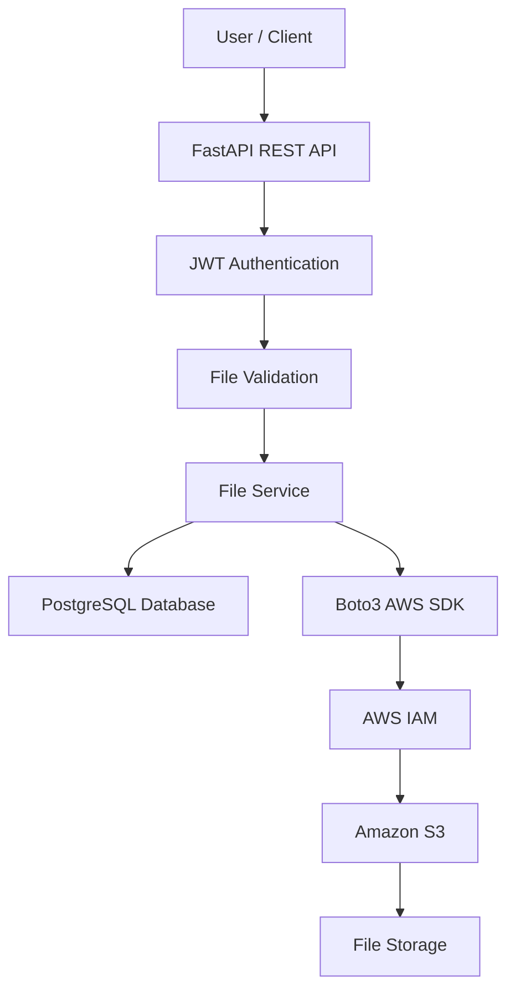

# ☁️ Cloud File Storage Application

A secure and scalable cloud-based file storage backend built using **Python, FastAPI, and AWS S3**. This project provides REST APIs for file management, user authentication, cloud storage integration, and secure file access.

## 🚀 Project Overview

The Cloud File Storage Application enables users to upload, download, list, and delete files using Amazon S3. It uses FastAPI for backend services, AWS IAM for access control, and PostgreSQL for managing user and file metadata.

## 🛠️ Technology Stack

| Technology | Purpose |
|---|---|
| Python | Backend programming |
| FastAPI | REST API development |
| AWS S3 | Cloud file storage |
| AWS IAM | Access management |
| Boto3 | AWS SDK |
| PostgreSQL | Database |
| SQLAlchemy | ORM |
| JWT | Authentication |
| Docker | Containerization |
| Pytest | Automated testing |
| Git & GitHub | Version control |

## ✨ Key Features

- Secure user registration and login
- JWT-based authentication
- Upload files to Amazon S3
- Download files from cloud storage
- List and manage uploaded files
- Delete stored files
- Generate pre-signed URLs
- File validation and metadata management
- IAM-based access control
- Centralized exception handling
- Structured application logging
- Docker-based deployment

## 🏗️ System Architecture



## 📂 Project Structure

```text
cloud-file-storage/
│
├── app/
│   ├── api/
│   │   └── routes/
│   ├── core/
│   ├── database/
│   ├── models/
│   ├── repositories/
│   ├── schemas/
│   ├── services/
│   ├── middleware/
│   └── main.py
│
├── tests/
├── docs/
├── infra/
├── migrations/
├── scripts/
│
├── Dockerfile
├── docker-compose.yml
├── requirements.txt
├── .env.example
├── .gitignore
└── README.md
```

## ⚙️ Installation and Setup

### 1. Clone the repository

```bash
git clone https://github.com/YOUR_USERNAME/cloud-file-storage.git
cd cloud-file-storage
```

### 2. Create a virtual environment

```bash
python -m venv venv
```

Activate on Windows:

```powershell
venv\Scripts\activate
```

### 3. Install dependencies

```bash
pip install -r requirements.txt
```

### 4. Configure environment variables

Copy the example configuration:

```powershell
Copy-Item .env.example .env
```

Configure your database, AWS region, S3 bucket name, and application settings in `.env`.

Never commit actual credentials or secret keys.

### 5. Configure AWS

- Create an Amazon S3 bucket.
- Enable S3 Block Public Access.
- Configure IAM permissions using least privilege.
- Configure AWS credentials using an IAM role or AWS CLI profile.
- Verify your AWS region and bucket configuration.

### 6. Run the application

```bash
uvicorn app.main:app --reload
```

Open the API documentation:

http://127.0.0.1:8000/docs

## 🐳 Docker Deployment

Build and run using Docker Compose:

```bash
docker compose up --build
```

## 🧪 Testing

Run automated tests:

```bash
pytest -v
```

## 🔐 Security Considerations

- Use IAM least-privilege permissions.
- Keep S3 buckets private.
- Never hardcode AWS credentials.
- Use JWT authentication.
- Validate uploaded files.
- Restrict user access to their own files.
- Store secrets in environment variables.
- Enable encryption for stored objects.

## 📚 Documentation

Additional documentation is available in the `docs/` directory:

- System architecture
- API documentation
- Development walkthrough
- Deployment instructions
- Security guidelines

## 🎯 Learning Outcomes

This project demonstrates practical experience in:

- Python backend engineering
- REST API development
- AWS cloud services
- Amazon S3 integration
- IAM security and permissions
- Database integration
- Authentication and authorization
- Docker and application deployment
- Testing and troubleshooting

## 👨‍💻 Author

**Manikanta Thalla**

Computer Science Engineering | Internet of Things

Interested in Cloud Engineering, Backend Development, and AWS Infrastructure.

---

⭐ If you find this project useful, consider giving it a star!
