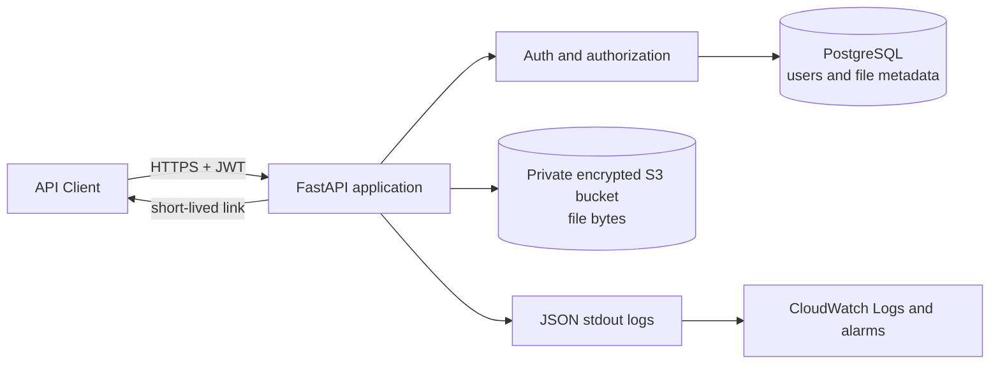
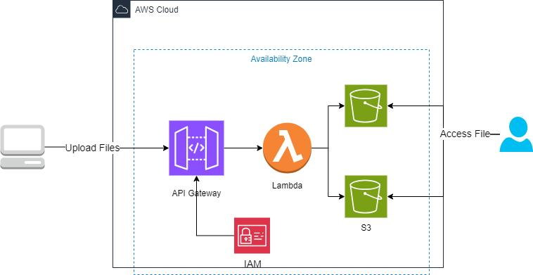
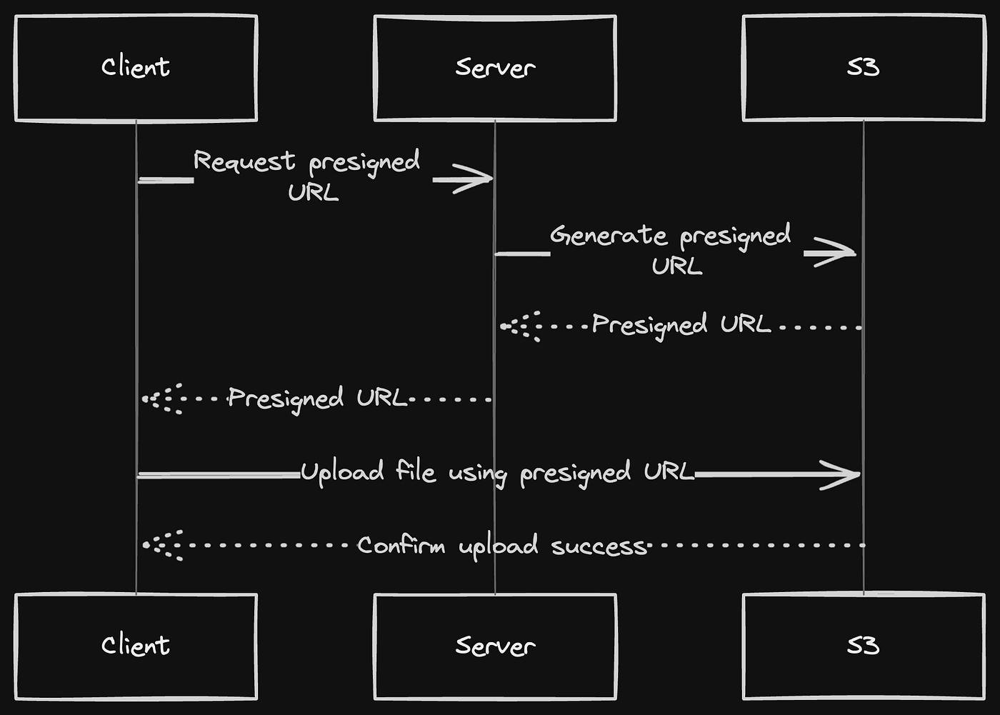
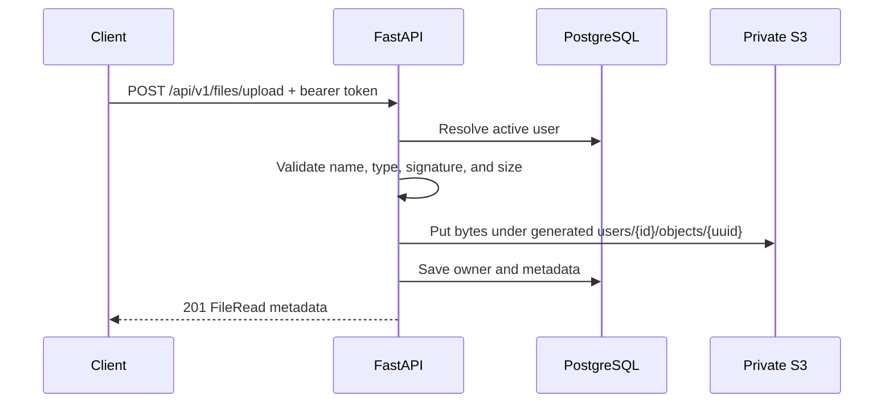
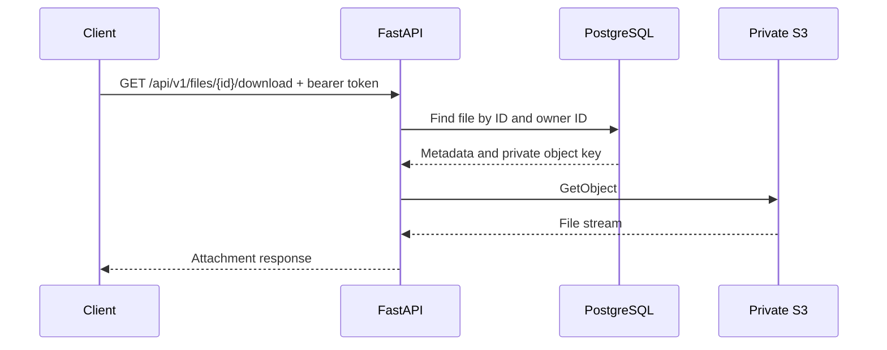
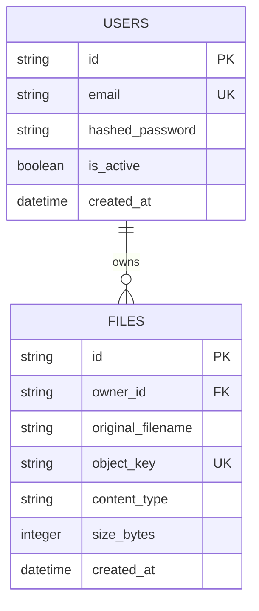

# Cloud File Storage API

A Python 3.12+ REST API for private, user-owned file storage. FastAPI handles the HTTP layer, PostgreSQL stores user and file metadata, and Amazon S3 stores encrypted file bytes. Authentication uses Argon2 password hashes and short-lived JWT access tokens.

## What it provides

- Registration and OAuth2 password login with JWT bearer tokens.
- Authenticated upload, metadata, download, deletion, and short-lived S3 download links.
- User-scoped file access: the API returns the same 404 response for a missing file and another user's file.
- Upload size, extension, content type, and common binary signature checks.
- UUID-based S3 keys; client-supplied filenames are metadata only.
- PostgreSQL persistence, Alembic migrations, filtering, and bounded pagination.
- Structured errors, JSON request logs, request IDs, health checks, and rate limits.
- Private bucket, IAM, Docker, CloudWatch, and deployment examples.

## Architecture



## Reference diagrams

The following diagrams were supplied as design references. They show two related AWS patterns, while the application architecture above describes the implementation in this repository.

### Serverless S3 architecture reference



The diagram shows a client sending an upload request to API Gateway, which invokes Lambda. Lambda accesses S3 using permissions granted through an IAM role. The picture contains two S3 buckets, but does not label why they are separate; a real design should use multiple buckets only when a clear isolation, retention, or lifecycle need calls for them. The user's file access arrow should mean an authorized method such as a short-lived pre-signed URL, not public bucket access.

This is a **serverless reference**, not the current deployment: this project uses FastAPI and PostgreSQL, and does not use API Gateway or Lambda. The private S3 bucket, encryption, and least-privilege IAM ideas do apply to the current project.

### Direct pre-signed upload flow reference



This flow lets a client ask the server for a short-lived S3 upload URL, send file bytes directly to S3, and then notify the server that the upload completed. The file bytes bypass the application server, which can reduce application bandwidth for larger uploads. The server still needs to authenticate the user, authorize the object key, and verify the completed object before recording it as available.

The current API implements pre-signed **downloads** at `GET /api/v1/files/{file_id}/presigned-url`. Uploads currently go through `POST /api/v1/files/upload`, where FastAPI validates the file, writes it to S3, and records its metadata. Direct pre-signed uploads and an upload-completion endpoint are not implemented by this project.

### Upload and download workflows





### Data model



## Project layout

```text
app/
  api/              Versioned routers and auth dependencies
  core/             Settings, JWT/password security, errors, logging, rate limits
  database/         SQLAlchemy base and session lifecycle
  models/            User and file metadata models
  repositories/      Database queries
  schemas/           Request and response contracts
  services/          Authentication, file workflows, and S3 adapter
  utils/             Filename and content validation
  main.py            FastAPI app, middleware, health endpoints
migrations/          Alembic environment and initial schema migration
infra/               Private S3 bucket and IAM policy examples
tests/               API tests with SQLite and Moto mocked S3
app/static/          Lightweight HTML/CSS landing page (served at `/app`)
docs/                 Security, API, and deployment guides
```

## Build

The API and the static landing page are packaged together in the Docker image. The page uses plain HTML, CSS, and a small scroll-reveal script, so it does not need a separate Node.js build.

Build the API image from this project directory:

```powershell
docker build -t cloud-file-storage:local .
```

To build the API service through Compose and start it with PostgreSQL, use:

```powershell
docker compose up --build
```

The API docs are available at <http://localhost:8000/docs>; the landing page is at <http://localhost:8000/app>. For local development, the page has a staggered file-list entrance, an animated storage bar and status light, gentle background motion, and hover/reveal transitions. It honors the browser's reduced-motion preference. These are presentation effects; the page links to the API docs and does not itself upload or manage files.

## Run locally

### Option A: Docker Compose with PostgreSQL

Use Python 3.12 or newer for local tooling and install Docker Desktop. From this project directory in PowerShell:

```powershell
Copy-Item .env.example .env
py -c "import secrets; print(secrets.token_urlsafe(48))"
```

Put the generated value in `SECRET_KEY`. Set `S3_BUCKET_NAME` to a private bucket you own and set `AWS_REGION`. The application uses the standard AWS credential provider chain; prefer an IAM role or a local AWS profile. Do not place AWS access keys in `.env` or commit them. For local containers, make your AWS profile available to the container using your normal Docker credential workflow.

```powershell
docker compose up --build
```

The API starts at <http://localhost:8000>; the animated app landing page is at <http://localhost:8000/app>, and interactive OpenAPI docs are at <http://localhost:8000/docs>. Compose runs `alembic upgrade head` before starting Uvicorn. The local PostgreSQL password defaults to `postgres`; change it for shared environments.

To use a local AWS CLI profile from Docker, mount it read-only with the optional override. In PowerShell, set `$env:AWS_CONFIG_DIR = "$env:USERPROFILE/.aws"` and run `docker compose -f docker-compose.yml -f docker-compose.aws-profile.yml up --build`. For ECS, use the task role instead of mounting profile files.

### Option B: Run the API on the host

Create a virtual environment and install dependencies:

```powershell
py -3.12 -m venv .venv
.\.venv\Scripts\Activate.ps1
python -m pip install -r requirements.txt
Copy-Item .env.example .env
```

For PostgreSQL, start a database and set `DATABASE_URL` in `.env`. For a quick local smoke run, SQLite is also supported by setting `DATABASE_URL=sqlite:///./cloud_file_storage.db`. Set a persistent random `SECRET_KEY`, `AWS_REGION`, and `S3_BUCKET_NAME` before using authenticated storage.

```powershell
alembic upgrade head
uvicorn app.main:app --reload
```

If no S3 bucket is configured, health checks and API docs still run, while file-storage operations return `503 storage_not_configured`.
Open <http://127.0.0.1:8000/app> to view the animated landing page.

### First API calls

Register an account:

```powershell
curl.exe -X POST http://127.0.0.1:8000/api/v1/auth/register `
  -H "Content-Type: application/json" `
  -d '{"email":"you@example.com","password":"a-long-unique-password"}'
```

Log in using form encoding (OAuth2 password flow):

```powershell
curl.exe -X POST http://127.0.0.1:8000/api/v1/auth/login `
  -H "Content-Type: application/x-www-form-urlencoded" `
  -d "username=you%40example.com&password=a-long-unique-password"
```

Copy `access_token` into `Authorization: Bearer <token>` for file routes. Swagger UI's Authorize button accepts the same credentials.

## API reference

All file routes require a valid bearer token.

| Method | Path | Purpose |
|---|---|---|
| `POST` | `/api/v1/auth/register` | Create an account; JSON email and password (minimum 12 characters) |
| `POST` | `/api/v1/auth/login` | Exchange form `username` (email) and password for a JWT |
| `POST` | `/api/v1/files/upload` | Upload one multipart `file` |
| `GET` | `/api/v1/files` | List owned files; `limit` (1–100), `offset`, `q`, `extension`, `created_from`, `created_to` |
| `GET` | `/api/v1/files/{file_id}` | Read owned file metadata |
| `GET` | `/api/v1/files/{file_id}/download` | Stream owned file content |
| `GET` | `/api/v1/files/{file_id}/presigned-url` | Create a short-lived S3 GET link |
| `DELETE` | `/api/v1/files/{file_id}` | Delete object and metadata; returns 204 |
| `GET` | `/health/live` | Process liveness |
| `GET` | `/health/ready` | Database readiness |

Allowed extensions: `.pdf`, `.png`, `.jpg`, `.jpeg`, `.txt`, `.csv`, `.docx`. Default maximum upload size is 25 MiB. Set `MAX_UPLOAD_BYTES` to change it.

Success responses use typed JSON schemas. Errors use a common envelope:

```json
{
  "error": {"code": "file_not_found", "message": "File was not found"},
  "request_id": "a-request-id"
}
```

See [docs/api.md](docs/api.md) for examples and status codes.

## Configuration

Copy `.env.example` and set values for your environment. Settings can also be supplied directly through environment variables.

| Variable | Purpose |
|---|---|
| `ENVIRONMENT` | Set to `production` to require an explicitly configured JWT secret |
| `DATABASE_URL` | SQLAlchemy URL; PostgreSQL is used by Compose and recommended for deployment |
| `SECRET_KEY` | Persistent high-entropy JWT signing key; never commit it |
| `ACCESS_TOKEN_EXPIRE_MINUTES` | JWT lifetime, 1–1440 minutes |
| `AWS_REGION` | S3 bucket region |
| `S3_BUCKET_NAME` | Private object bucket name |
| `S3_KMS_KEY_ID` | Optional customer managed KMS key; otherwise SSE-S3 is used |
| `PRESIGNED_URL_EXPIRE_SECONDS` | S3 link lifetime, 60–3600 seconds |
| `MAX_UPLOAD_BYTES` | Maximum accepted file size |
| `RATE_LIMIT_STORAGE_URI` | SlowAPI storage; use shared Redis for multi-worker deployments |
| `LOG_LEVEL` | Python logging level; logs are JSON to stdout |

## Testing

The suite uses SQLite for metadata and Moto to mock S3. It does not contact AWS or need a running PostgreSQL server.

```powershell
python -m pip install -r requirements.txt
pytest -q
```

## GitHub repository setup

If you create a standalone GitHub repository for this project, initialize and push it from this project directory:

```powershell
git init
git branch -M main
git add .
git commit -m "Build cloud file storage API"
git remote add origin https://github.com/YOUR_USER/cloud-file-storage.git
git push -u origin main
```

The `.gitignore` excludes `.env`, local databases, virtual environments, logs, and test caches. Never commit AWS credentials, signing keys, or production database URLs.

## AWS setup and deployment

1. Create the bucket from `infra/s3-bucket.yaml`; it blocks public access, enforces TLS, enables bucket-owner ownership, versioning, and default SSE-S3 encryption.
2. Attach `infra/iam-policy.json` to the ECS task role after replacing the bucket name. It grants only `PutObject`, `GetObject`, and `DeleteObject` beneath the application's `users/*` object prefix.
3. Deploy the API on ECS/Fargate with private subnets, an ALB with HTTPS, a PostgreSQL RDS instance in private subnets, and Secrets Manager values for `SECRET_KEY` and `DATABASE_URL`.
4. Set the container's `AWS_REGION`, `S3_BUCKET_NAME`, `S3_KMS_KEY_ID` (if used), `RATE_LIMIT_STORAGE_URI`, and log level. Use the task role for AWS calls; do not distribute IAM access keys.
5. Run `alembic upgrade head` as a release migration task before shifting traffic. Compose opts into startup migrations for the local single-service setup; set `RUN_MIGRATIONS=false` on production service tasks and run a dedicated migration task.
6. Send container stdout/stderr to CloudWatch Logs. Configure alarms for elevated 5xx responses, throttling, container restarts, high latency, database saturation, and S3 4xx/5xx metrics.

Full steps and operational notes are in [docs/deployment.md](docs/deployment.md), [docs/security.md](docs/security.md), and [docs/architecture.md](docs/architecture.md).

## Operational notes

- The default rate limiter uses in-process memory for local development. Use Redis via `RATE_LIMIT_STORAGE_URI=redis://...` in multi-worker or multi-task deployments so limits are shared.
- JWT fallback keys are randomly generated per process for local-only use. Production must set the same durable secret in Secrets Manager for every replica.
- S3 object keys do not use user-supplied filenames. Original names appear only in metadata and attachment headers.
- Deleting a file removes the S3 object before committing metadata deletion. If the database commit fails after S3 deletion, operators may need to restore metadata from backup; monitor database errors and use database backups.
- The example bucket enables versioning for recovery. A delete marker hides the file immediately; noncurrent versions expire after 30 days. Adjust that retention to match privacy and recovery requirements.

## Troubleshooting

- `storage_not_configured`: set `S3_BUCKET_NAME` and `AWS_REGION`.
- `storage_permission_error`: check the task role policy and bucket name; use the request ID to find the JSON log entry.
- `database_unavailable`: verify `DATABASE_URL`, network/security-group rules, and that migrations completed.
- `401 invalid_token`: log in again after token expiry; ensure all API replicas share the same `SECRET_KEY`.
- Docker cannot reach S3: provide credentials via a supported AWS credential provider in the container or deploy with a task role; host AWS CLI credentials are not automatically inherited by Docker.

## Portfolio notes

This project demonstrates API design, relational modeling, authentication, object storage, least-privilege IAM, containerization, migrations, cloud logging, and mocked integration testing. Before a public deployment, choose a real domain and TLS certificate, configure managed secrets and Redis, review account verification/password reset requirements, and run a security assessment.
