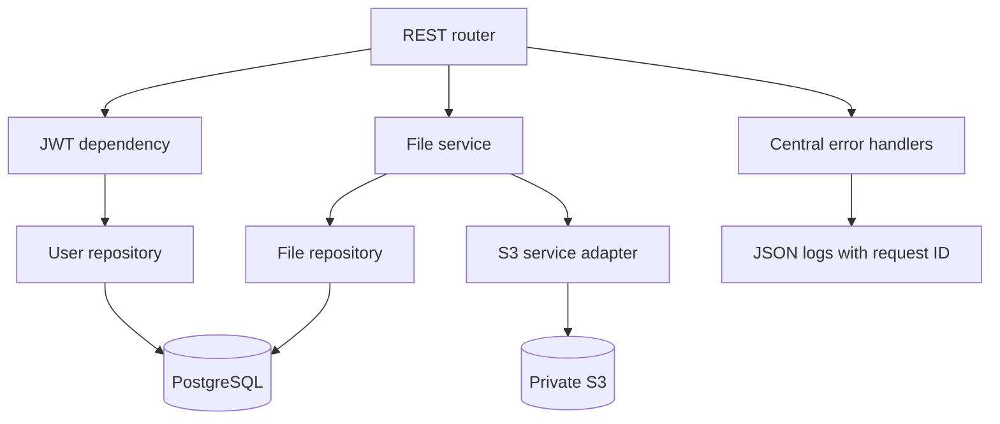

# Architecture

The service keeps object bytes in S3 and stores ownership and searchable metadata in PostgreSQL. Application operations are separated into routers, services, repositories, and infrastructure adapters.

## Responsibility by module

- `app/api/routes`: HTTP paths, response contracts, and request parameter validation.
- `app/api/dependencies.py`: JWT validation and active-user lookup.
- `app/services`: business workflows such as authentication and upload compensation.
- `app/repositories`: SQL queries and transaction commits.
- `app/services/s3_service.py`: lazy Boto3 client and AWS error translation.
- `app/models` and `app/schemas`: persistence entities and public API shapes.
- `app/core`: environment settings, password/JWT operations, rate limiting, logging, and error responses.
- `migrations`: schema evolution. Production deploys should run the migration separately before application rollout.

The upload workflow validates the request, writes bytes to a generated owner-scoped key, and commits metadata. If metadata persistence fails, it attempts to delete the object. Downloads first resolve metadata by both file ID and owner ID, then stream the S3 body. The API never returns another user's object key.
